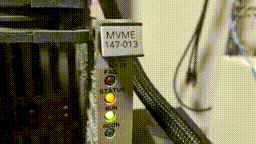

### Ho ho ho

I wondered how people made a page about how great they are appear on their profile and now I know!

Have some blinkenlights for your efforts:

#### AI policy

- I am one weirdo that likes messing with old crappy hardware. I'm going to use AI to get stuff done before I die. Anything marked with the *slop* topic was generated entirely or substantially using AI and I have only checked that it appears to work and not the quality. caveat emptor.

#### Why do I make everything GPLv3

- Because I don't actually want you to use it for anything serious and the GPL, especially v3, scares most people off and I can lead a happy life.

#### Achievements

- First double free added to the kernel: https://github.com/torvalds/linux/commit/0b9266d295cee170509539635b8d572abe5267af
- First Phoronix famous: https://www.phoronix.com/news/Linux-PCI-Amiga-4000
- Second Phoronix famous: https://www.phoronix.com/news/Linux-7.3-FBDEV
- First hackernews famous: https://news.ycombinator.com/item?id=48720186

#### Work flow:

- Github actions are updating my copies of repos like Linux, u-boot etc once a day.
- My branches are a crime against humanity.
- TODO list is here: https://github.com/fifteenhex/too-much-to-do-too-little-time
